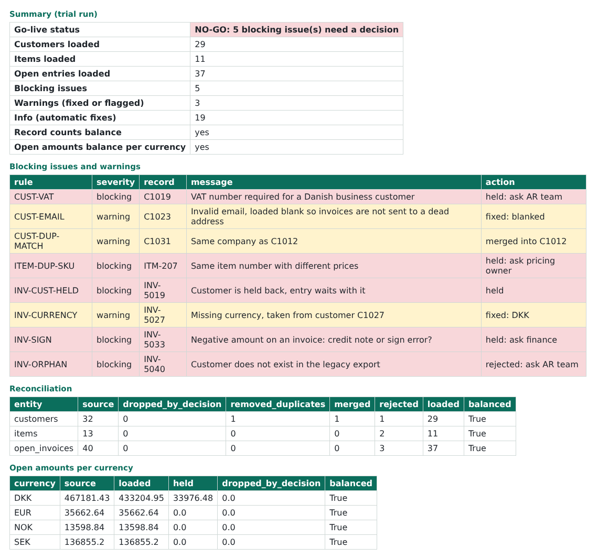

# ERP Data Migration

A small but complete data migration from a legacy ERP export to load files for a new ERP
(column names in the style of Dynamics 365 Business Central configuration packages).
It cleanses and validates the data, merges duplicate customers, reconciles every record
and every krone back to the source, and produces an Excel report the business can act on.

I built it to practise the part of a system implementation that decides whether go-live
goes well: getting the data right, and being able to prove it is right.



## What it does

```
legacy_customers.csv  --+                          +-- load_Customers.csv
legacy_items.csv      --+--> cleanse, validate --+-- load_Items.csv
legacy_open_invoices  --+    de-duplicate          +-- load_OpenCustomerEntries.csv
decisions.yaml        --+    reconcile             +-- issue_log.csv, migration_report.xlsx
```

1. **Map** each legacy field to the target template (`migrate/mapping.yaml`). When a field
   moves, the mapping changes, not the code.
2. **Cleanse**: free-text countries (`Danmark`, `Sverige`, `dk`) become ISO codes, dates in
   `dd-mm-yyyy` and `yyyy-mm-dd` become one format, Danish amounts like `1.234,50` and
   `1234.50` both become whole øre, so sums never pick up floating point errors.
3. **Validate** with named rules. Each rule is either *blocking* (the record is held back and
   someone must decide) or a *warning* (fixed automatically and written down).
4. **De-duplicate** customers: identical rows are removed, and the same company created twice
   (same VAT number, or the same name once `A/S`, `AS`, `ApS`, `AB`, `GmbH` are ignored) is merged.
   The oldest customer number survives because history points to it, and open entries on the
   merged number are moved to the survivor.
5. **Reconcile**: for every entity, source rows = dropped by decision + identical copies removed +
   merged + held + loaded. For open entries, the amount per currency must also balance to the
   cent: source = loaded + held + dropped by decision.
6. **Report**: a go/no-go status, the issue log coloured by severity, the reconciliation, the
   dedupe map and the load sheets in one workbook.

## The trial run and the decision loop

A real migration is run many times before go-live. The first trial on the sample data finds
5 blocking issues and says **NO-GO**, even though every number reconciles:

| Rule | Record | Problem | Who decides |
|---|---|---|---|
| CUST-VAT | C1019 | Danish business customer without a VAT number | AR team |
| ITEM-DUP-SKU | ITM-207 | same item number with two different prices | Pricing owner |
| INV-CUST-HELD | INV-5019 | entry belongs to the held customer C1019 | follows C1019 |
| INV-SIGN | INV-5033 | negative amount typed as an invoice, not a credit note | Finance |
| INV-ORPHAN | INV-5040 | open entry for customer C1999, who does not exist | AR team |

The answers go into a decisions file (`decisions.example.yaml`), each with who decided and why.
The next run applies them before cleansing, logs each one as `DECISION`, and the status turns
**GO**. The decisions file becomes the audit trail.

Automatic fixes are logged too: the merged customer C1031, its entry moved to C1012, a missing
currency taken from the customer master, an invalid email loaded blank so invoices don't go to a
dead address.

## Run it

```bash
pip install -r requirements.txt
python -m migrate sample --out data/legacy        # synthetic legacy export
python -m migrate run --source data/legacy        # trial run: NO-GO, report in output/
python -m migrate run --source data/legacy --decisions decisions.example.yaml --out output_go --strict
```

`--strict` exits with code 1 unless the status is GO, so the run can gate a pipeline.

## Things I learned

- **Reconcile amounts, not just row counts.** Row counts balanced from the start. The amount
  check is what showed that dropping a record by decision has to be accounted for separately,
  otherwise the source total quietly shrinks.
- **Never drop a record silently.** Every removed, merged or held row has a line in the issue log
  with the rule, the value and the action.
- **Decisions belong to the business.** The code does not guess which of two prices is right;
  it holds the item and names who should decide.
- **Fail loudly on stale decisions.** A decision that matches no record raises an error, so an
  old decisions file can't be applied to new data by mistake.

## Tests and CI

18 tests with `unittest`: parsing (both amount formats, impossible dates such as 31 February),
every planted problem caught by the right rule, duplicate merge and entry move, amounts
reconciling to the cent, decisions turning NO-GO into GO, idempotent re-runs, and the workbook
and load file structure. GitHub Actions runs the tests on Python 3.11 to 3.13, checks that the
trial run fails the strict gate and the decided run passes it, and uploads both reports.

The sample data is synthetic (`migrate/sample.py`); `PLANTED` lists every problem in it.
